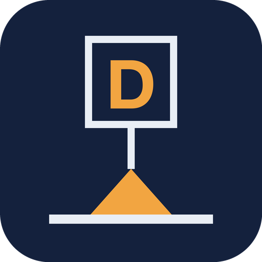
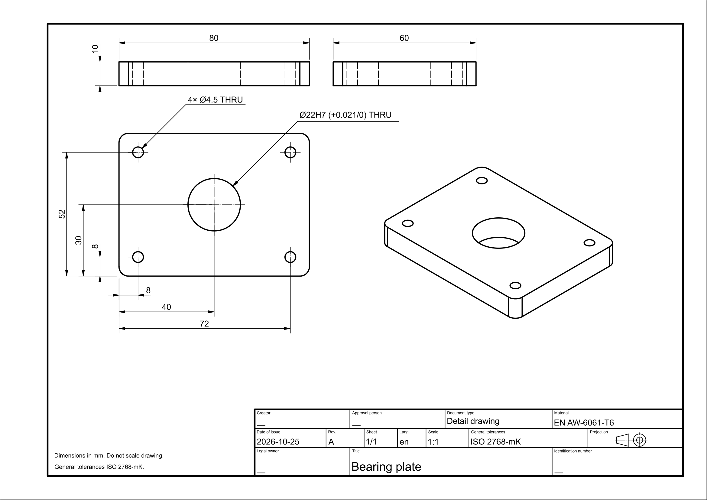
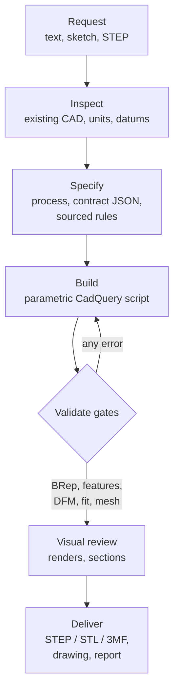
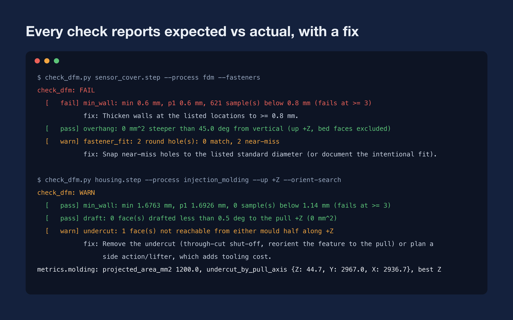
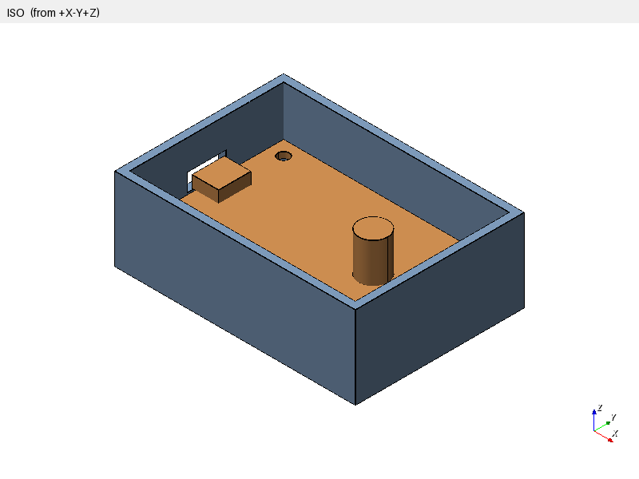
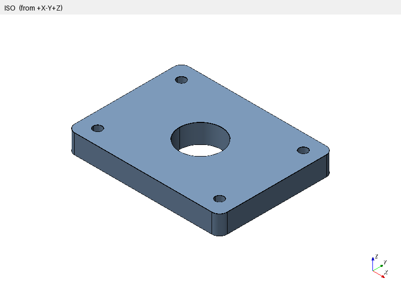
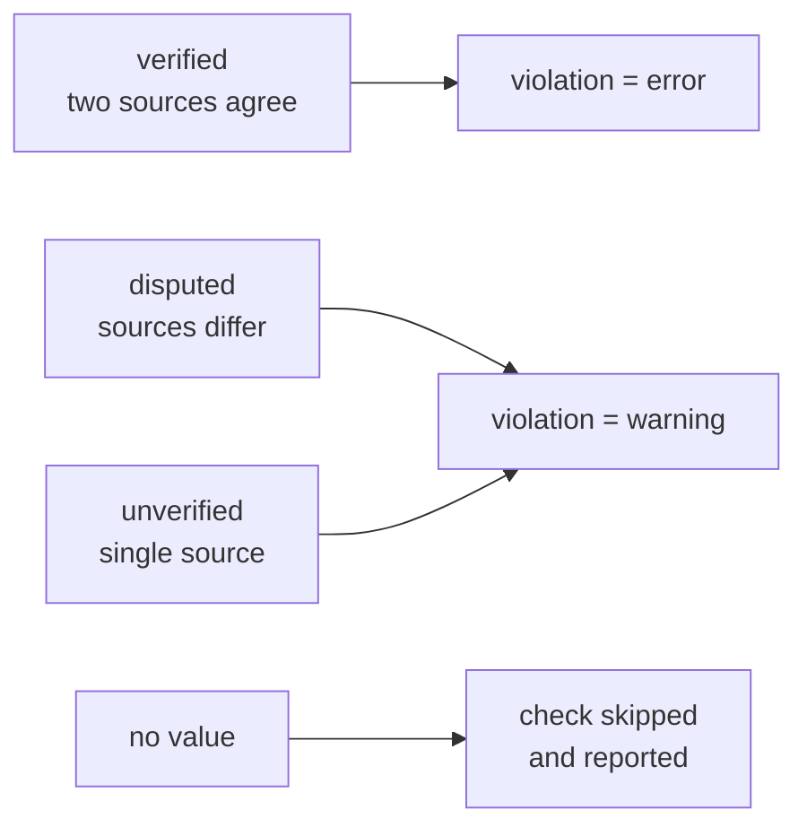
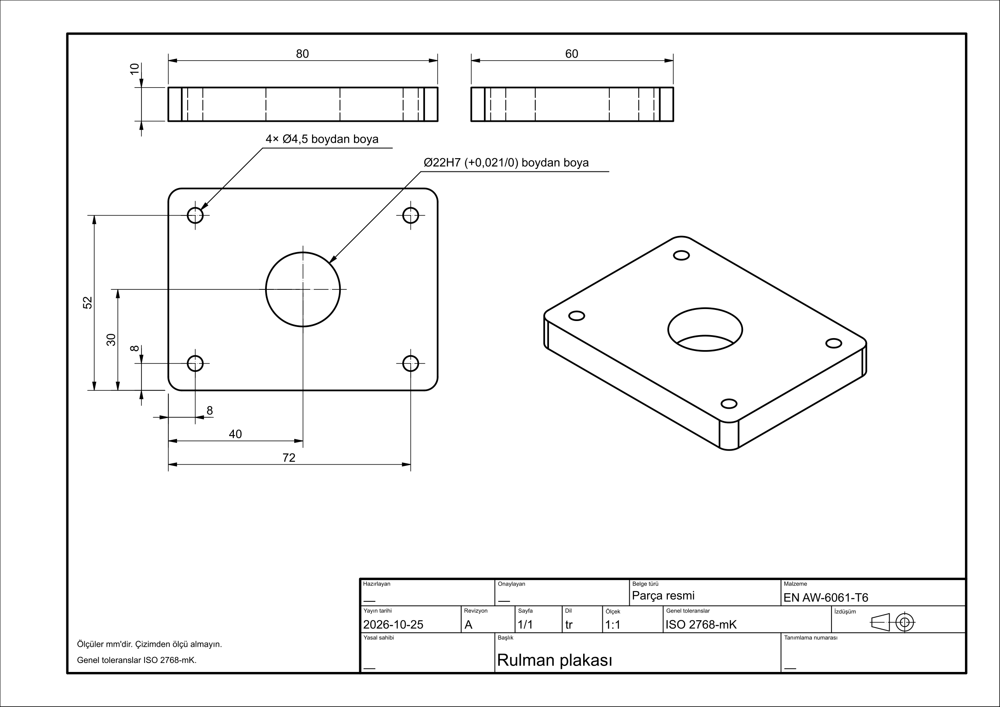
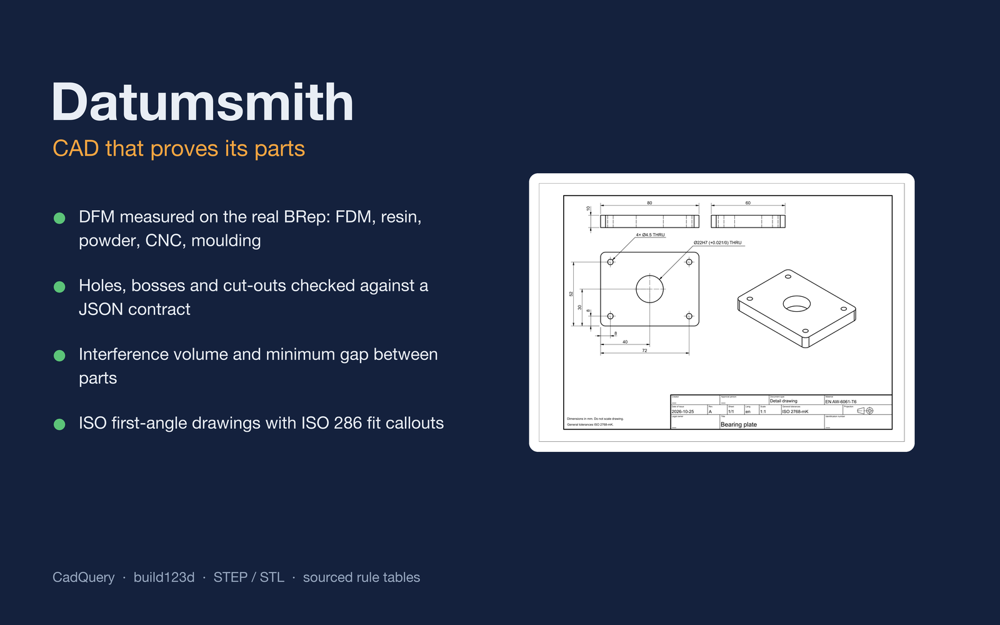
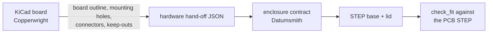

<div align="center">



# Datumsmith

**A mechanical CAD skill for coding agents that checks its own work.**

[English](README.md) · [Türkçe](README.tr.md)

[](https://www.agensi.io/r/SERDARVARAN?to=/skills/datumsmith-cad-that-proves-its-parts-cadquery-dfm-iso)




</div>

Datumsmith teaches Claude Code, Codex CLI, Cursor and other coding agents to design parametric parts in
CadQuery **and then prove them**. Every design rule it applies comes from a cited source, and every delivered STEP is
measured by deterministic checkers before the agent is allowed to call the job done.

> An agent that writes a CAD script is not the same as an agent that delivers a part you can print, machine or mould.
> Datumsmith closes that gap with numbers, not adjectives.

---

## Contents

- [Why Datumsmith](#why-datumsmith)
- [How it works](#how-it-works)
- [What it checks](#what-it-checks)
- [Rule library](#rule-library)
- [Technical drawings](#technical-drawings)
- [Get Datumsmith](#get-datumsmith)
- [Usage](#usage)
- [Tools reference](#tools-reference)
- [What's included](#whats-included)
- [Testing and evaluation](#testing-and-evaluation)
- [Limits](#limits)
- [License](#license)

## Why Datumsmith

| Without it | With Datumsmith |
|---|---|
| The agent picks "about 3 mm" for an M3 hole | ISO 273 clearance (`3.4 mm`, medium series) or the CNC Kitchen insert hole (`4.0 mm`) from a sourced table |
| "Looks fine" after the script runs | `check_features` measures every hole, boss and cut-out on the BRep against the contract |
| Walls, overhangs and draft are eyeballed in a render | `check_dfm` measures them on the real geometry for the chosen process and orientation |
| Lid and PCB collide on the first print | `check_fit` reports interference volume and minimum gap between parts |
| A drawing is a screenshot | An ISO first-angle sheet with a title block, dimensions from a datum and ISO 286 fit callouts |

## How it works



1. **Inspect** the request and any existing model; record units, datums and what must not change.
2. **Specify** the manufacturing process first, because it sets every limit. Write a small JSON contract of the
   features that matter (holes, bosses, cut-outs, keep-outs).
3. **Build** an editable, parametric CadQuery script. Neutral CAD (STEP) stays the source of truth; meshes are derived.
4. **Validate** with the gates below. A failed gate sends the agent back to the script, not to the report.
5. **Deliver** the files, a drawing when requested, and a report that lists what was checked and what was assumed.

Agents follow twelve hard rules in `SKILL.md`. Examples: never invent dimensions of purchased parts when a drawing
exists, never claim PASS without the gates, keep design intent editable.

## What it checks

### Design for manufacturing on the real geometry

`check_dfm.py` tessellates the BRep and measures, for the chosen process and build or pull direction:

| Check | What it measures |
|---|---|
| `min_wall` | Wall thickness by inward ray casting; only faces that really oppose count, so drafted walls and acute edges are not false alarms |
| `overhang`, `bridge` | Downward faces steeper than the process limit, and flat ceilings short enough to bridge |
| `fdm_horizontal_hole` | Horizontal holes over 5 mm, unless they have a teardrop or flat-top roof pointing up |
| `min_hole`, `min_pin`, `min_feature` | Smallest holes, pins and features against the process minimum |
| `enclosed_void` | Sealed cavities (resin and powder processes need drain or escape holes) |
| `bed_chamfer` | Unchamfered bed-contact edges that will show elephant foot |
| `fastener_fit` | Every round hole against ISO 273 clearance, tap-drill and heat-set insert tables |
| `draft`, `draft_typical` | Injection moulding draft per face; exact for planes and for cylinders and cones along the pull |
| `undercut` | Surfaces no mould half can reach along the pull: they need a side action or lifter |
| Projected area | Silhouette on the parting plane, the input to clamp-force estimates |

`--orient-search` reports the overhang area for all six print orientations, or the undercut area for each pull
axis in moulding.

<p align="center"></p>

<details>
<summary>Plain-text output</summary>

```text
$ check_dfm.py sensor_cover.step --process fdm --fasteners
check_dfm: FAIL
  [   fail] min_wall: min 0.6 mm, p1 0.6 mm, 621 sample(s) below 0.8 mm (fails at >= 3)
            fix: Thicken walls at the listed locations to >= 0.8 mm.
  [   pass] overhang: 0 mm^2 steeper than 45.0 deg from vertical (up +Z, bed faces excluded)
  [   warn] fastener_fit: 2 round hole(s): 0 match, 2 near-miss
            fix: Snap near-miss holes to the listed standard diameter (or document the intentional fit).
```

```text
$ check_dfm.py housing.step --process injection_molding --up +Z --orient-search
check_dfm: WARN
  [   pass] min_wall: min 1.6763 mm, p1 1.6926 mm, 0 sample(s) below 1.14 mm (fails at >= 3)
  [   pass] draft: 0 face(s) drafted less than 0.5 deg to the pull +Z (0 mm^2)
  [   warn] undercut: 1 face(s) not reachable from either mould half along +Z
            fix: Remove the undercut (through-cut shut-off, reorient the feature to the pull) or plan a
                 side action/lifter, which adds tooling cost.
metrics.molding: projected_area_mm2 1200.0, undercut_by_pull_axis {Z: 44.7, Y: 2967.0, X: 2936.7}, best Z
```

</details>

### Design contracts and fit

`check_features.py` reads a JSON contract and finds each feature on the STEP itself. A script that ran but put a
hole 0.3 mm off, at the wrong size or not all the way through is reported by feature id:

```json
{"features": [
  {"id": "mount_1", "type": "hole", "center": [4, 4, 0], "axis": [0, 0, 1], "diameter": 4.0, "depth": 6.7},
  {"id": "usb_c", "type": "cutout", "center": [-2.5, 20, 3.2], "normal": [-1, 0, 0], "up": [0, 0, 1],
   "width": 9.5, "height": 3.6, "probe_depth": 6.0},
  {"id": "antenna", "type": "keepout", "min": [40, 0, 0], "max": [60, 15, 10]}
]}
```

`check_fit.py` measures the interference volume and the minimum gap between two parts, for example a base and its
PCB, or a lid in its assembled position. `mesh_preflight.py` checks exported STL/3MF for watertightness, body count,
unit scale and volume against the STEP.

<p align="center">
  
  
</p>

`render_views.py` and `section_views.py` produce fixed-camera renders and measured sections. The skill requires the
agent to look at them before handing over: renders catch what numbers miss, numbers catch what renders hide.

## Rule library

Every numeric value lives in the skill's rule tables with a source tag and a confidence status, and a validator
keeps the tables complete.



| File | Contents | Verified | Disputed | Unverified |
|---|---|---:|---:|---:|
| `processes.json` | 9 processes: FDM, SLA Form 4, generic SLA, SLS PA12, MJF PA12, metal LPBF, CNC milling, injection moulding, sheet metal | 54 | 16 | 4 |
| `fasteners.json` | ISO 273 clearance (close/medium/free), ISO 2306 tap drills, heat-set inserts, ISO 4032 nuts, ISO 4762 heads, DIN 974 counterbores, ISO 10642 countersinks (M2–M8) | 17 | 2 | 2 |
| `tolerances.json` | ISO 2768-1 linear, radius/chamfer and angular tolerances; fit guidance for printed parts | 6 | 1 | 8 |
| `iso286.json` | ISO 286 IT5–IT11, shaft deviations c–s, hole deviations H, G, F, JS, K, M, N, P, up to 500 mm | 30 | 2 | 3 |
| `materials.json` | Engineering plastics and print materials | 6 | 2 | 6 |

The skill also ships a human-readable version of every table with its sources, so the agent can explain each number.

## Technical drawings

`make_drawing.py` runs in its own build123d environment and produces ISO 5456-2 first-angle drawings:

- front, top, side and isometric views with hidden lines;
- ISO 7200 title block, projection symbol and general tolerance note, in **English or Turkish** (decimal comma);
- automatic overall, wall-thickness, hole/boss position (from a datum) and cut-out dimensions; identical holes
  grouped into one callout;
- ISO 286 fit callouts from the feature contract: `"fit": "H7"` prints `Ø22H7 (+0,021/0)`; `"tol": [0.1, -0.05]`
  prints `+0,1/-0,05`;
- SVG, PDF, DXF and PNG output, plus a JSON list of every dimension and every one it skipped, with the reason.

Title-block people fields (owner, author, approver) and the document number are left empty unless the user gives
them; the report lists them as missing instead of inventing names.

<p align="center"></p>

## Get Datumsmith

Datumsmith is sold on **[Agensi](https://www.agensi.io/r/SERDARVARAN?to=/skills/datumsmith-cad-that-proves-its-parts-cadquery-dfm-iso)**
as a one-time purchase. This repository is its public page: the skill itself is not distributed here.

<p align="center"><a href="https://www.agensi.io/r/SERDARVARAN?to=/skills/datumsmith-cad-that-proves-its-parts-cadquery-dfm-iso"></a></p>

1. Open the [Datumsmith listing](https://www.agensi.io/r/SERDARVARAN?to=/skills/datumsmith-cad-that-proves-its-parts-cadquery-dfm-iso) and buy it.
2. Connect your agent to Agensi once (`https://mcp.agensi.io/mcp/auth`, sign-in, no API key). Claude Code, Codex CLI,
   Cursor, VS Code and other agents with remote MCP support work.
3. Ask for CAD work in plain language. Your agent loads the latest version of the skill every time.

Every paid Agensi skill has a 30-day money-back guarantee.

### Requirements on your machine

- An agent that can run local commands. Browser-only chat cannot run the checkers.
- Python 3.11 or newer with CadQuery 2.8, trimesh and rtree:

  ```bash
  uv venv --python 3.12 ~/.venvs/cadquery
  uv pip install --python ~/.venvs/cadquery cadquery trimesh rtree
  ```

- For drawings, build123d in **its own** environment (it pins a different OCP version than CadQuery; never mix them):

  ```bash
  uv venv --python 3.12 ~/.venvs/build123d
  uv pip install --python ~/.venvs/build123d build123d
  ```

- Other locations work through the `CADQUERY_PYTHON` and `BUILD123D_PYTHON` environment variables. The skill checks
  the environment first and tells you what is missing.

## Usage

Ask in plain language; the skill triggers on CAD, DFM, enclosure and drawing requests:

- *"Design a PETG wall bracket for two M5 screws, 2 kg load, and give me a Turkish drawing."*
- *"Make a two-part enclosure for this PCB STEP with M3 heat-set inserts and a USB-C opening."*
- *"Check this part for injection moulding with the mould opening along Z."*
- *"Is this STL printable on SLA? Fix it if not."*
- *"Add a Ø22 H7 bearing seat to this aluminium plate and produce a drawing for the machinist."*

## Tools reference

All scripts print a JSON report on stdout and a human summary on stderr. Exit codes: `0` pass or warn, `1` fail,
`2` input error.

| Script | Purpose |
|---|---|
| `find_cadquery_python.sh`, `find_build123d_python.sh` | Find the right interpreter for each environment |
| `check_environment` | Verify CadQuery, trimesh, rtree and optionally build123d and FreeCAD |
| `validate_step.py` | STEP import, solid count, validity, bounding box |
| `check_features.py` | Feature contract against the BRep |
| `check_fit.py` | Interference volume and minimum clearance between two parts |
| `check_dfm.py` | Process DFM, orientation search, fasteners, moulding draft and undercuts |
| `mesh_preflight.py`, `export_mesh.py` | STL/3MF export and mesh checks |
| `render_views.py`, `section_views.py` | Renders, contact sheet and measured sections |
| `make_drawing.py` | ISO first-angle drawing (SVG/PDF/DXF/PNG) |
| `iso286.py` | ISO 286 limits and fits: `iso286.py 22 H7`, `iso286.py 20 H7/g6` |
| `generate_enclosure.py`, `validate_enclosure.py`, `release_enclosure.py` | Contract-driven electronics enclosures |

## What's included

| Part | Contents |
|---|---|
| `SKILL.md` | The workflow and the twelve hard rules the agent follows |
| Rule tables | Sourced numeric rules for nine processes, fasteners, tolerances, ISO 286 and materials |
| References | Rule summaries with sources, CadQuery and FreeCAD notes, design contracts, visual review |
| Scripts | 18 self-contained checkers and tools: DFM, features, fit, STEP and mesh checks, renders, drawings, enclosures |
| Template | An example enclosure contract |

## Testing and evaluation

The 111 tests build parts that are deliberately wrong (thin walls, undrafted walls, side holes, misplaced or missing holes,
colliding lids, teardrops pointing down) and assert that each checker rejects them for the right reason, while the
correct versions pass. The same suite runs against the exact scripts Agensi delivers.

The skill was also exercised on real tasks run end to end by Claude and Codex with the skill installed: an FDM L
bracket with clearance holes and a drawing, a two-part enclosure around a given PCB, and the repair of a part with a
0.6 mm wall and undersized holes. A grader judged only the delivered STEP files and reports.

## Limits

Datumsmith reduces mistakes; it does not certify parts.

- Rule values come from public design guides and standards summaries, each marked with its confidence. Your
  supplier's specification wins over them.
- ISO 286 fits assume machined or reamed surfaces. Printed parts use process clearances; the skill says so.
- Loads, fatigue, creep and safety factors need engineering review; the skill estimates, it does not sign off.
- Print or machine a test piece before production.

## License

Copyright 2026 Serdar Kaan Varan, VRNSoft. All rights reserved; see [LICENSE.md](LICENSE.md).

The skill is licensed to each buyer through Agensi under the
[Agensi Terms of Service](https://www.agensi.io/terms). This repository contains documentation and images only;
they may not be copied or redistributed without permission.

The Agensi links in this README are affiliate links: if you sign up through one, I earn a commission on what you buy
in your first six months, at no extra cost to you.

## Related

- [Copperwright](https://github.com/serdarvaran/copperwright): the electronics companion. KiCad audits, ESP32 pin
  rules and fabrication outputs, with a mechanical hand-off into Datumsmith enclosures.
  [Get it on Agensi](https://www.agensi.io/r/SERDARVARAN?to=/skills/copperwright-kicad-esp32-board-audits-before-you-order).


