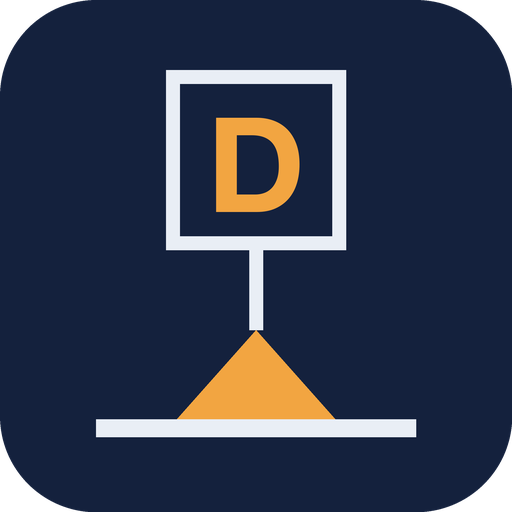
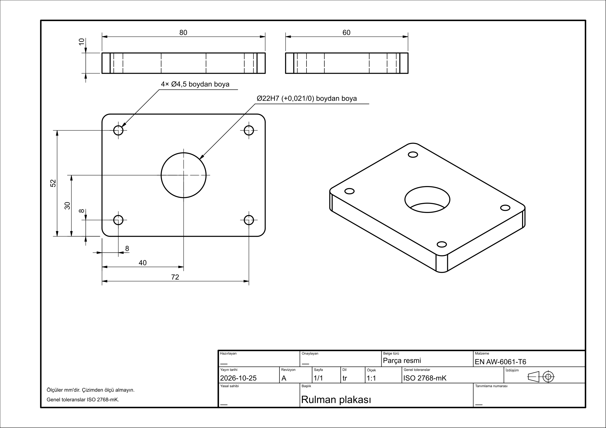
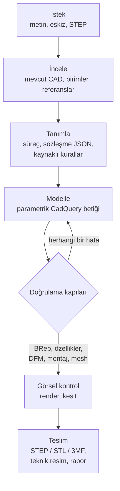
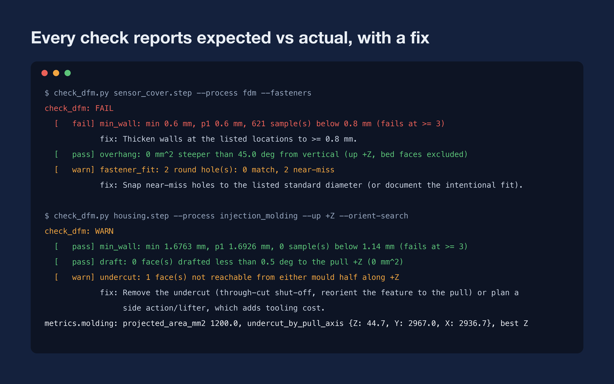
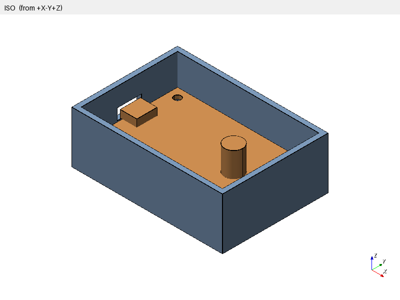
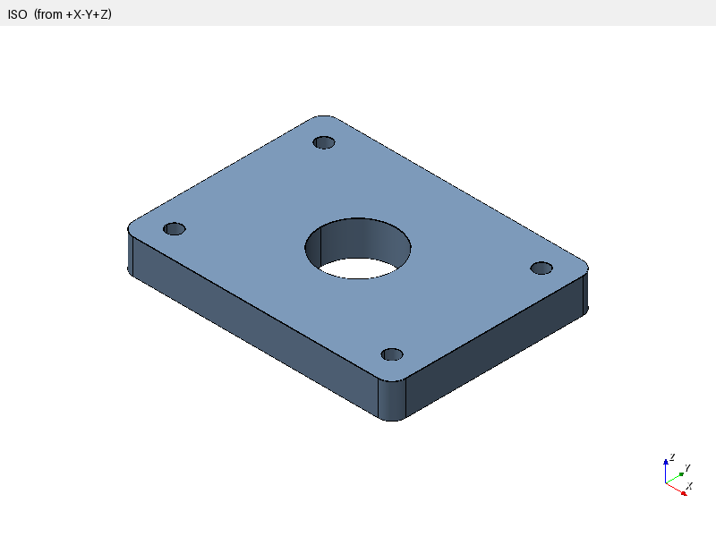
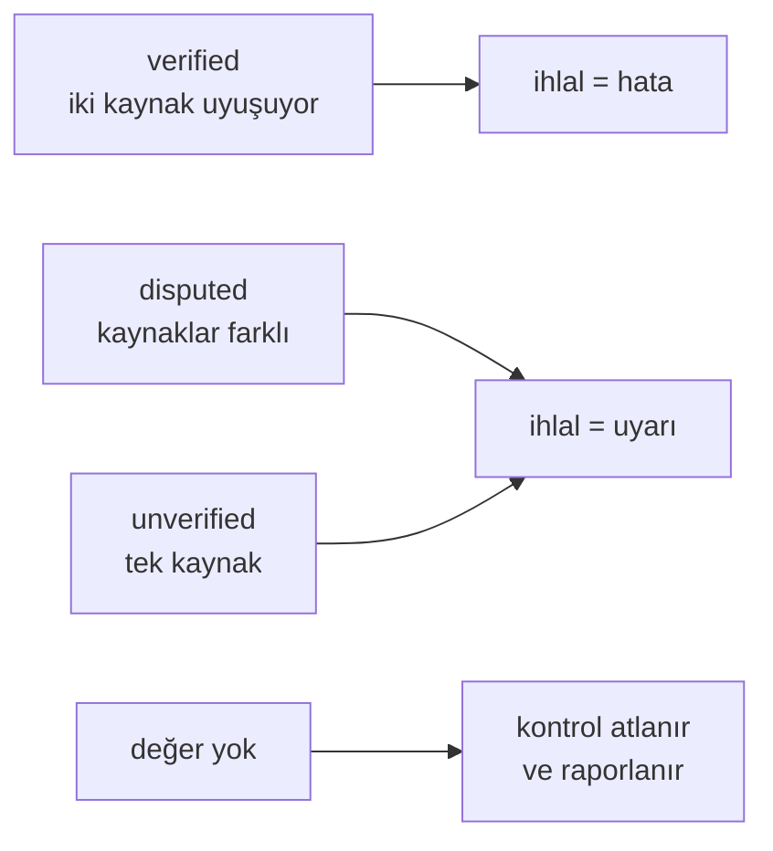
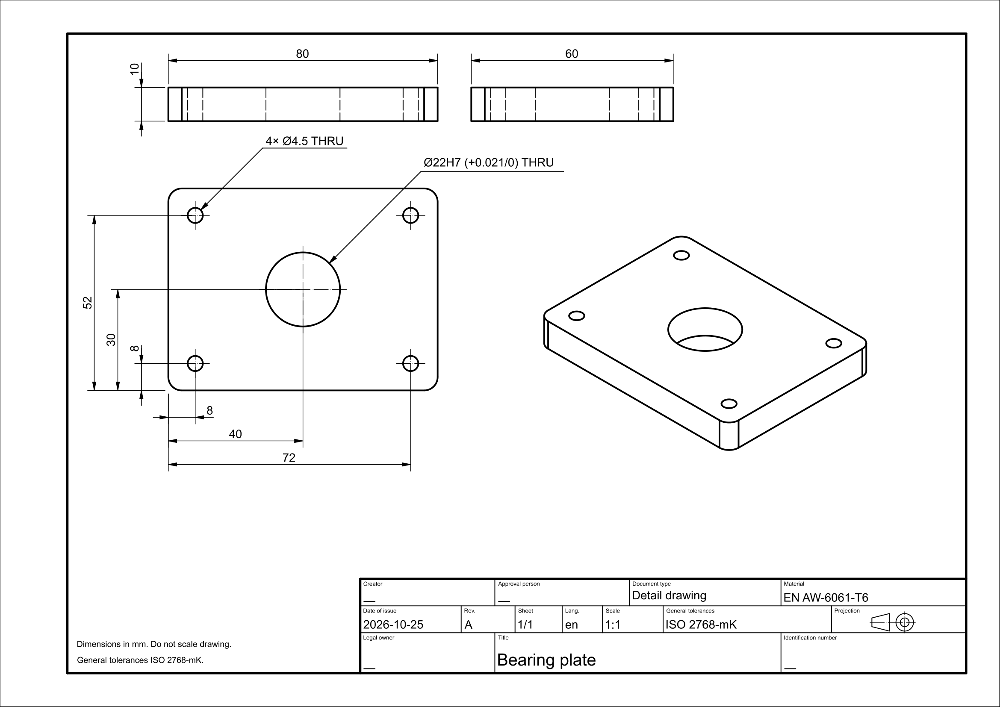
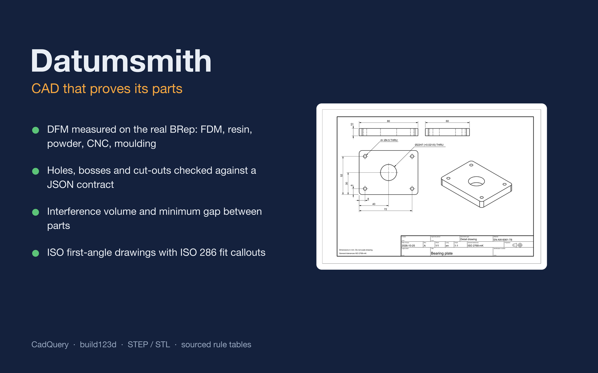
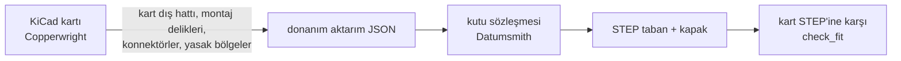

<div align="center">



# Datumsmith

**Kendi işini kontrol eden, kodlama ajanları için mekanik CAD becerisi.**

[English](README.md) · [Türkçe](README.tr.md)

[](https://www.agensi.io/r/SERDARVARAN?to=/skills/datumsmith-cad-that-proves-its-parts-cadquery-dfm-iso)




</div>

Datumsmith; Claude Code, Codex CLI, Cursor ve diğer kodlama ajanlarına CadQuery ile parametrik
parça tasarlamayı **ve ardından bu parçayı kanıtlamayı** öğretir. Uyguladığı her tasarım kuralı kaynaklı bir
tablodan gelir. Teslim edilen her STEP, ajan "bitti" diyebilmeden önce deterministik denetleyicilerle ölçülür.

> CAD betiği yazan bir ajan ile basılabilen, işlenebilen ya da kalıplanabilen bir parça teslim eden ajan aynı şey
> değildir. Datumsmith bu farkı sıfatlarla değil, sayılarla kapatır.

---

## İçindekiler

- [Neden Datumsmith](#neden-datumsmith)
- [Nasıl çalışır](#nasıl-çalışır)
- [Neleri kontrol eder](#neleri-kontrol-eder)
- [Kural kütüphanesi](#kural-kütüphanesi)
- [Teknik resim](#teknik-resim)
- [Datumsmith'i edinin](#datumsmithi-edinin)
- [Kullanım](#kullanım)
- [Araçlar](#araçlar)
- [Pakette neler var](#pakette-neler-var)
- [Testler ve değerlendirme](#testler-ve-değerlendirme)
- [Sınırlar](#sınırlar)
- [Lisans](#lisans)

## Neden Datumsmith

| Beceri olmadan | Datumsmith ile |
|---|---|
| Ajan M3 delik için "3 mm civarı" seçer | Kaynaklı tablodan ISO 273 geçiş deliği (`3,4 mm`, orta seri) ya da CNC Kitchen insert deliği (`4,0 mm`) |
| Betik çalışınca "iyi görünüyor" denir | `check_features` her deliği, çıkıntıyı ve açıklığı sözleşmeye göre BRep üzerinde ölçer |
| Et kalınlığı, sarkma ve kalıp açısı renderdan tahmin edilir | `check_dfm` bunları seçilen süreç ve yön için gerçek geometride ölçer |
| Kapak ilk baskıda karta çarpar | `check_fit` parçalar arasındaki çakışma hacmini ve en küçük boşluğu raporlar |
| Teknik resim bir ekran görüntüsüdür | Başlık kutulu, referanstan ölçülendirilmiş, ISO 286 geçme gösterimli birinci açı ISO paftası |

## Nasıl çalışır



1. **İncele:** isteği ve varsa mevcut modeli inceler. Birimleri, referans yüzeyleri ve değişmemesi gerekenleri kaydeder.
2. **Tanımla:** önce üretim sürecini seçer, çünkü bütün sınırları süreç belirler. Önemli özellikler (delikler,
   çıkıntılar, açıklıklar, yasak bölgeler) için küçük bir JSON sözleşmesi yazar.
3. **Modelle:** düzenlenebilir, parametrik bir CadQuery betiği yazar. Doğruluk kaynağı nötr CAD'dir (STEP); mesh
   dosyaları ondan türetilir.
4. **Doğrula:** aşağıdaki kapılardan geçirir. Kapıdan kalan iş rapora değil, betiğe geri döner.
5. **Teslim et:** dosyaları, istenirse teknik resmi, neyin kontrol edildiğini ve neyin varsayıldığını yazan raporu verir.

Ajan `SKILL.md` içindeki on iki kesin kurala uyar. Örneğin satın alınan parçanın çizimi varsa ölçü uydurmaz,
kapılardan geçmeden PASS demez, tasarım niyetini düzenlenebilir tutar.

## Neleri kontrol eder

### Gerçek geometride üretilebilirlik (DFM)

`check_dfm.py`, BRep'i üçgenlere böler ve seçilen süreç ile baskı ya da kalıp açılma yönü için şunları ölçer:

| Kontrol | Ne ölçer |
|---|---|
| `min_wall` | İçeri doğru ışınlarla et kalınlığı. Yalnızca gerçekten karşı karşıya bakan yüzeyler sayılır; açılı duvarlar ve keskin kenarlar sahte hata üretmez |
| `overhang`, `bridge` | Süreç sınırından dik aşağı bakan yüzeyler ve köprülenebilecek kadar kısa düz tavanlar |
| `fdm_horizontal_hole` | 5 mm'den büyük yatay delikler; ucu yukarı bakan damla ya da düz tavan profili varsa uyarı vermez |
| `min_hole`, `min_pin`, `min_feature` | En küçük delik, pim ve detayın süreç alt sınırıyla karşılaştırılması |
| `enclosed_void` | Kapalı boşluklar (reçine ve toz süreçleri tahliye deliği ister) |
| `bed_chamfer` | Tablaya oturan, pahsız kenarlar (fil ayağı yapar) |
| `fastener_fit` | Her yuvarlak deliğin ISO 273 geçiş, kılavuz matkabı ve ısıl gömme insert tablolarıyla karşılaştırılması |
| `draft`, `draft_typical` | Enjeksiyonda yüz başına kalıp çıkış açısı; düzlem ile açılma yönündeki silindir ve konilerde tam değer |
| `undercut` | Kalıbın iki yarısının da açılma yönünde ulaşamadığı yüzeyler: yan maça ya da lifter gerekir |
| İzdüşüm alanı | Ayırma düzlemindeki siluet; kalıp kapama kuvveti hesabının girdisi |

`--orient-search`, baskıda altı yönün her biri için sarkma alanını, enjeksiyonda her açılma ekseni için girinti
alanını raporlar.

<p align="center"></p>

<details>
<summary>Düz metin çıktısı</summary>

```text
$ check_dfm.py sensor_cover.step --process fdm --fasteners
check_dfm: FAIL
  [   fail] min_wall: min 0.6 mm, p1 0.6 mm, 621 sample(s) below 0.8 mm (fails at >= 3)
            fix: Thicken walls at the listed locations to >= 0.8 mm.
  [   pass] overhang: 0 mm^2 steeper than 45.0 deg from vertical (up +Z, bed faces excluded)
  [   warn] fastener_fit: 2 round hole(s): 0 match, 2 near-miss
            fix: Snap near-miss holes to the listed standard diameter (or document the intentional fit).
```

```text
$ check_dfm.py housing.step --process injection_molding --up +Z --orient-search
check_dfm: WARN
  [   pass] min_wall: min 1.6763 mm, p1 1.6926 mm, 0 sample(s) below 1.14 mm (fails at >= 3)
  [   pass] draft: 0 face(s) drafted less than 0.5 deg to the pull +Z (0 mm^2)
  [   warn] undercut: 1 face(s) not reachable from either mould half along +Z
            fix: Remove the undercut (through-cut shut-off, reorient the feature to the pull) or plan a
                 side action/lifter, which adds tooling cost.
metrics.molding: projected_area_mm2 1200.0, undercut_by_pull_axis {Z: 44.7, Y: 2967.0, X: 2936.7}, best Z
```

</details>

Araç çıktıları, ajanların ve araçların ortak dili olduğu için İngilizcedir. Ajan sonuçları kullanıcının dilinde
raporlar.

### Tasarım sözleşmesi ve montaj

`check_features.py` bir JSON sözleşmesini okur ve her özelliği STEP'in kendisinde arar. Çalışan ama deliği 0,3 mm
kaydırmış, yanlış çapta açmış ya da sona kadar delmemiş bir betik, özellik adıyla raporlanır:

```json
{"features": [
  {"id": "mount_1", "type": "hole", "center": [4, 4, 0], "axis": [0, 0, 1], "diameter": 4.0, "depth": 6.7},
  {"id": "usb_c", "type": "cutout", "center": [-2.5, 20, 3.2], "normal": [-1, 0, 0], "up": [0, 0, 1],
   "width": 9.5, "height": 3.6, "probe_depth": 6.0},
  {"id": "antenna", "type": "keepout", "min": [40, 0, 0], "max": [60, 15, 10]}
]}
```

`check_fit.py`, iki parça arasındaki çakışma hacmini ve en küçük boşluğu ölçer: örneğin kutu tabanı ile kart, ya da
montajlı konumdaki kapak. `mesh_preflight.py`, dışa aktarılan STL/3MF'in su geçirmezliğini, gövde sayısını, birim
ölçeğini ve hacmini STEP ile karşılaştırır.

<p align="center">
  
  
</p>

`render_views.py` ve `section_views.py` sabit kameralı renderlar ve ölçümlü kesitler üretir. Beceri, ajanın teslimden
önce bunlara bakmasını zorunlu tutar: renderlar sayıların kaçırdığını, sayılar renderların gizlediğini yakalar.

## Kural kütüphanesi

Her sayısal değer, kaynak etiketi ve güven durumuyla birlikte becerinin kural tablolarında durur; bir doğrulayıcı
tabloların eksiksiz kalmasını sağlar.



| Dosya | İçerik | Doğrulanmış | Tartışmalı | Doğrulanmamış |
|---|---|---:|---:|---:|
| `processes.json` | 9 süreç: FDM, SLA Form 4, genel SLA, SLS PA12, MJF PA12, metal LPBF, CNC frezeleme, plastik enjeksiyon, sac metal | 54 | 16 | 4 |
| `fasteners.json` | ISO 273 geçiş delikleri (hassas/orta/kaba), ISO 2306 kılavuz matkapları, ısıl gömme insertler, ISO 4032 somunlar, ISO 4762 başlar, DIN 974 havşa yuvaları, ISO 10642 havşa başlar (M2–M8) | 17 | 2 | 2 |
| `tolerances.json` | ISO 2768-1 doğrusal, radyüs/pah ve açısal toleranslar; baskı parçaları için geçme önerileri | 6 | 1 | 8 |
| `iso286.json` | ISO 286 IT5–IT11, mil sapmaları c–s, delik sapmaları H, G, F, JS, K, M, N, P; 500 mm'ye kadar | 30 | 2 | 3 |
| `materials.json` | Mühendislik plastikleri ve baskı malzemeleri | 6 | 2 | 6 |

Beceri her tablonun kaynaklarıyla birlikte okunabilir bir sürümünü de içerir; ajan her sayıyı açıklayabilir.

## Teknik resim

`make_drawing.py` kendi build123d ortamında çalışır ve ISO 5456-2 birinci açı paftası üretir:

- gizli çizgili ön, üst, yan ve izometrik görünüşler;
- ISO 7200 başlık kutusu, izdüşüm sembolü ve genel tolerans notu; **Türkçe ya da İngilizce** (Türkçede ondalık virgül);
- otomatik toplam ölçüler, et kalınlığı, referanstan delik/çıkıntı konumları ve açıklık ölçüleri; aynı delikler tek
  ölçüde gruplanır;
- sözleşmeden ISO 286 geçme gösterimi: `"fit": "H7"` resme `Ø22H7 (+0,021/0)` olarak, `"tol": [0.1, -0.05]`
  `+0,1/-0,05` olarak geçer;
- SVG, PDF, DXF ve PNG çıktı; ayrıca her ölçünün ve atlanan her ölçünün gerekçesiyle JSON listesi.

Başlık kutusundaki kişi alanları (yasal sahip, hazırlayan, onaylayan) ve belge numarası, kullanıcı vermedikçe boş
bırakılır. Rapor, isim uydurmak yerine bunları eksik olarak listeler.

<p align="center"></p>

## Datumsmith'i edinin

Datumsmith **[Agensi](https://www.agensi.io/r/SERDARVARAN?to=/skills/datumsmith-cad-that-proves-its-parts-cadquery-dfm-iso)** üzerinden tek seferlik satın alma ile satılır. Bu depo becerinin tanıtım sayfasıdır;
becerinin kendisi burada dağıtılmaz.

<p align="center"><a href="https://www.agensi.io/r/SERDARVARAN?to=/skills/datumsmith-cad-that-proves-its-parts-cadquery-dfm-iso"></a></p>

1. [Datumsmith ilanını](https://www.agensi.io/r/SERDARVARAN?to=/skills/datumsmith-cad-that-proves-its-parts-cadquery-dfm-iso) açın ve satın alın.
2. Ajanınızı Agensi'ye bir kez bağlayın (`https://mcp.agensi.io/mcp/auth`, oturum açma; API anahtarı gerekmez).
   Claude Code, Codex CLI, Cursor, VS Code ve uzak MCP destekleyen diğer ajanlar çalışır.
3. CAD işini düz bir dille isteyin. Ajanınız her seferinde becerinin en güncel sürümünü yükler.

Agensi'deki her ücretli beceride 30 günlük para iade garantisi vardır.

### Bilgisayarınızda gerekenler

- Yerel komut çalıştırabilen bir ajan. Yalnızca tarayıcıda çalışan sohbet denetleyicileri çalıştıramaz.
- CadQuery 2.8, trimesh ve rtree ile Python 3.11 ya da üstü:

  ```bash
  uv venv --python 3.12 ~/.venvs/cadquery
  uv pip install --python ~/.venvs/cadquery cadquery trimesh rtree
  ```

- Teknik resim için **ayrı bir ortamda** build123d (CadQuery'den farklı bir OCP sürümüne bağlı; ikisini asla aynı
  ortama kurmayın):

  ```bash
  uv venv --python 3.12 ~/.venvs/build123d
  uv pip install --python ~/.venvs/build123d build123d
  ```

- Farklı konumlar `CADQUERY_PYTHON` ve `BUILD123D_PYTHON` ortam değişkenleriyle tanıtılabilir. Beceri önce ortamı
  kontrol eder ve eksik olanı söyler.

## Kullanım

Düz bir dille isteyin; beceri CAD, DFM, kutu ve teknik resim isteklerinde devreye girer:

- *"İki M5 vidayla duvara takılacak, 2 kg taşıyan PETG bir braket tasarla ve Türkçe teknik resmini ver."*
- *"Bu kartın STEP'i için M3 ısıl gömme insertli, USB-C açıklıklı iki parçalı bir kutu yap."*
- *"Bu parçayı kalıp Z yönünde açılacak şekilde enjeksiyona uygunluk açısından kontrol et."*
- *"Bu STL SLA'da basılabilir mi? Değilse düzelt."*
- *"Bu alüminyum plakaya Ø22 H7 rulman yuvası ekle ve tornacı için teknik resim çıkar."*

## Araçlar

Tüm betikler stdout'a JSON rapor, stderr'e okunabilir özet yazar. Çıkış kodları: `0` geçti ya da uyarı, `1` kaldı,
`2` girdi hatası.

| Betik | Görevi |
|---|---|
| `find_cadquery_python.sh`, `find_build123d_python.sh` | Her ortam için doğru yorumlayıcıyı bulur |
| `check_environment` | CadQuery, trimesh, rtree ve isteğe bağlı build123d ile FreeCAD kurulumunu doğrular |
| `validate_step.py` | STEP içe aktarma, katı sayısı, geçerlilik, sınır kutusu |
| `check_features.py` | Özellik sözleşmesini BRep'e karşı denetler |
| `check_fit.py` | İki parça arasındaki çakışma hacmi ve en küçük boşluk |
| `check_dfm.py` | Süreç DFM'si, yön araması, bağlantı elemanları, kalıp açısı ve girintiler |
| `mesh_preflight.py`, `export_mesh.py` | STL/3MF dışa aktarma ve mesh kontrolleri |
| `render_views.py`, `section_views.py` | Renderlar, toplu görünüm sayfası ve ölçümlü kesitler |
| `make_drawing.py` | Birinci açı ISO teknik resim (SVG/PDF/DXF/PNG) |
| `iso286.py` | ISO 286 sınırları ve geçmeler: `iso286.py 22 H7`, `iso286.py 20 H7/g6` |
| `generate_enclosure.py`, `validate_enclosure.py`, `release_enclosure.py` | Sözleşmeyle elektronik kutusu üretimi |

## Pakette neler var

| Bölüm | İçerik |
|---|---|
| `SKILL.md` | Ajanın izlediği iş akışı ve on iki kesin kural |
| Kural tabloları | Dokuz süreç, bağlantı elemanları, toleranslar, ISO 286 ve malzemeler için kaynaklı sayısal kurallar |
| Referanslar | Kaynaklı kural özetleri, CadQuery ve FreeCAD notları, tasarım sözleşmeleri, görsel kontrol |
| Betikler | Kendi başına çalışan 18 denetleyici ve araç: DFM, özellikler, montaj, STEP ve mesh kontrolleri, render, teknik resim, kutular |
| Şablon | Örnek bir kutu sözleşmesi |

## Testler ve değerlendirme

111 test, kasıtlı olarak hatalı parçalar üretir: ince duvarlar, açısız duvarlar, yan delikler, kaymış ya da eksik
delikler, çakışan kapaklar, ucu aşağı bakan damla delikler. Testler her denetleyicinin bunları doğru gerekçeyle
reddettiğini, doğru sürümleri ise geçirdiğini doğrular. Aynı test takımı Agensi'nin teslim ettiği betiklerin kendisine karşı da çalıştırılır.

Beceri ayrıca, kurulu olduğu Claude ve Codex tarafından baştan sona çalıştırılan gerçek görevlerle sınandı:
- geçiş delikli ve teknik resimli bir FDM L braket;
- verilen bir kartın etrafına iki parçalı kutu;
- 0,6 mm duvarlı ve küçük delikli bir parçanın düzeltilmesi.

Puanlayıcı yalnızca teslim edilen STEP dosyalarına ve raporlara baktı.

## Sınırlar

Datumsmith hataları azaltır; parçaları sertifikalandırmaz.

- Kural değerleri herkese açık tasarım kılavuzlarından ve standart özetlerinden gelir, her biri güven durumuyla
  işaretlidir. Tedarikçinizin şartnamesi her zaman önce gelir.
- ISO 286 geçmeleri işlenmiş ya da raybalanmış yüzeyler içindir. Baskı parçaları süreç boşluklarını kullanır; beceri
  bunu açıkça söyler.
- Yük, yorulma, sünme ve emniyet katsayıları mühendislik incelemesi ister; beceri tahmin eder, onay vermez.
- Üretimden önce bir deneme parçası basın ya da işleyin.

## Lisans

Telif hakkı 2026 Serdar Kaan Varan, VRNSoft. Tüm hakları saklıdır; bkz. [LICENSE.md](LICENSE.md).

Beceri her alıcıya Agensi üzerinden [Agensi Kullanım Koşulları](https://www.agensi.io/terms) kapsamında lisanslanır.
Bu depo yalnızca dokümantasyon ve görsel içerir; izin alınmadan kopyalanamaz ya da dağıtılamaz.

Bu README'deki Agensi linkleri ortaklık (affiliate) linkleridir: bunlardan biriyle kayıt olursanız ilk altı ayda
yaptığınız alımlardan komisyon kazanırım. Size ek bir maliyeti yoktur.

## İlgili proje

- [Copperwright](https://github.com/serdarvaran/copperwright): elektronik tarafındaki eşi. KiCad denetimleri,
  ESP32 pin kuralları ve üretim çıktıları sağlar; mekanik bilgiyi Datumsmith kutularına aktarır.
  [Agensi'den edinin](https://www.agensi.io/r/SERDARVARAN?to=/skills/copperwright-kicad-esp32-board-audits-before-you-order).


